<h1><picture>
  <source media="(max-width: 600px) and (prefers-reduced-motion: reduce)" srcset="./assets/desert-mobile-static.svg" />
  <source media="(prefers-reduced-motion: reduce)" srcset="./assets/desert-static.svg" />
  <source media="(max-width: 600px)" srcset="./assets/desert-mobile.svg" />
  
</picture></h1>

  <a href="#user-content-workbench">Activity</a> &nbsp;·&nbsp;
  <a href="./work/README.md">Selected work</a> &nbsp;·&nbsp;
  <a href="#user-content-research">Research</a> &nbsp;·&nbsp;
  <a href="mailto:medgleiguem00@gmail.com">Contact</a>

<picture>
  <source media="(max-width: 600px) and (prefers-reduced-motion: reduce)" srcset="./assets/workbench-mobile-static.svg" />
  <source media="(prefers-reduced-motion: reduce)" srcset="./assets/workbench-static.svg" />
  <source media="(max-width: 600px)" srcset="./assets/workbench-mobile.svg" />
  
</picture>

<a href="./data/activity.json">Activity data ↗</a>

<picture>
  <source media="(max-width: 600px) and (prefers-reduced-motion: reduce)" srcset="./assets/tools-rail-mobile-static.svg" />
  <source media="(prefers-reduced-motion: reduce)" srcset="./assets/tools-rail-static.svg" />
  <source media="(max-width: 600px)" srcset="./assets/tools-rail-mobile.svg" />
  
</picture>

More from the toolbox

FastAPI · Django · React · Next.js · pgvector · Airflow · dbt · Redis

<strong>Current threads</strong>

  <a href="./work/hassaniya-laghn.md">Hassaniya language</a> &nbsp;·&nbsp;
  <a href="./work/mauritanian-sign-language.md">Mauritanian sign language</a>

<a href="./work/README.md"><strong>Selected work ↗</strong></a>

<picture>
  <source media="(max-width: 600px) and (prefers-reduced-motion: reduce)" srcset="./assets/desert-footer-mobile-static.svg" />
  <source media="(prefers-reduced-motion: reduce)" srcset="./assets/desert-footer-static.svg" />
  <source media="(max-width: 600px)" srcset="./assets/desert-footer-mobile.svg" />
  
</picture>

  <a href="https://github.com/Medgleiguem?tab=repositories">GitHub</a> &nbsp;·&nbsp;
  <a href="https://www.linkedin.com/in/med-gleiguem/">LinkedIn</a> &nbsp;·&nbsp;
  <a href="mailto:medgleiguem00@gmail.com">Email</a>

