<h1><picture>
  <source media="(max-width: 600px)" srcset="./assets/entrance-mobile.svg" />
  
</picture></h1>

<picture>
  <source media="(max-width: 600px)" srcset="./assets/terminal-mobile.svg" />
  
</picture>

<h2><picture>
  <source media="(max-width: 600px)" srcset="./assets/section-projects-mobile.svg" />
  
</picture></h2>

<picture>
  <source media="(max-width: 600px)" srcset="./assets/systems-ai-mobile.svg" />
  
</picture>

<picture>
  <source media="(max-width: 600px)" srcset="./assets/systems-platforms-mobile.svg" />
  
</picture>

<h2><picture>
  <source media="(max-width: 600px)" srcset="./assets/section-research-mobile.svg" />
  
</picture></h2>

<picture>
  <source media="(max-width: 600px)" srcset="./assets/research-mobile.svg" />
  
</picture>

<h2><picture>
  <source media="(max-width: 600px)" srcset="./assets/section-arsenal-mobile.svg" />
  
</picture></h2>

<picture>
  <source media="(max-width: 600px)" srcset="./assets/arsenal-mobile.svg" />
  
</picture>

<h2><picture>
  <source media="(max-width: 600px)" srcset="./assets/section-activity-mobile.svg" />
  
</picture></h2>

<picture>
  <source media="(max-width: 600px) and (prefers-reduced-motion: reduce)" srcset="./assets/activity-mobile-static.svg" />
  <source media="(prefers-reduced-motion: reduce)" srcset="./assets/activity-static.svg" />
  <source media="(max-width: 600px)" srcset="./assets/activity-mobile.svg" />
  
</picture>

<picture>
  <source media="(max-width: 600px) and (prefers-reduced-motion: reduce)" srcset="./assets/skyline-mobile-static.svg" />
  <source media="(prefers-reduced-motion: reduce)" srcset="./assets/skyline-static.svg" />
  <source media="(max-width: 600px)" srcset="./assets/skyline-mobile.svg" />
  
</picture>

<picture>
  <source media="(prefers-reduced-motion: reduce)" srcset="./assets/contributions-static.svg" />
  
</picture>

<picture>
  <source media="(max-width: 600px)" srcset="./assets/signoff-mobile.svg" />
  
</picture>


[Sonora](https://github.com/Medgleiguem/sonora-music-hub) · [AI Diwan](https://el-mejlise.vercel.app) · [Activity refresh](https://github.com/Medgleiguem/Medgleiguem/actions/workflows/profile-activity.yml)

