<picture>
  <source media="(max-width: 600px)" srcset="./assets/banner-mobile.svg" />
  
</picture>

<picture>
  <source media="(max-width: 600px)" srcset="./assets/roles-mobile.svg" />
  
</picture>

<h1 align="center">Mohamed Gleiguem</h1>

<b>Technical Lead · Richat Partners</b> 
Building institutional AI, national data platforms and software rooted in Mauritanian reality. 
Security competitor and mentor. Arabic-language researcher. Web and mobile builder.

  
  
  
  

<a href="#workbench">Workbench</a> · <a href="#projects">Projects</a> · <a href="#research">Research</a> · <a href="#stack">Stack</a> · <a href="#activity">Activity</a>

 

<h2><picture>
  <source media="(max-width: 600px)" srcset="./assets/section-focus-mobile.svg" />
  
</picture></h2>

<picture>
  <source media="(max-width: 600px)" srcset="./assets/focus-mobile.svg" />
  
</picture>

 

<h2><picture>
  <source media="(max-width: 600px)" srcset="./assets/section-impact-mobile.svg" />
  
</picture></h2>

<picture>
  <source media="(max-width: 600px)" srcset="./assets/metrics-mobile.svg" />
  
</picture>

 

<h2><picture>
  <source media="(max-width: 600px)" srcset="./assets/section-domains-mobile.svg" />
  
</picture></h2>

<picture>
  <source media="(max-width: 600px)" srcset="./assets/domains-mobile.svg" />
  
</picture>

 

<h2><picture>
  <source media="(max-width: 600px)" srcset="./assets/section-work-mobile.svg" />
  
</picture></h2>

<picture>
  <source media="(max-width: 600px)" srcset="./assets/work-mobile.svg" />
  
</picture>

<b>Explore public work</b> 
<a href="https://el-mejlise.vercel.app">AI Diwan live</a> ·
<a href="https://github.com/Medgleiguem/sonora-music-hub">Sonora source</a> ·
<a href="https://sonora-music-hub-six.vercel.app">Sonora web player</a> ·
<a href="https://sonora-music-hub-six.vercel.app/android">Android downloads</a>

<b>Inside two public products — desktop and phone previews</b>

### AI Diwan

<a href="https://el-mejlise.vercel.app">
<picture>
  <source media="(max-width: 600px)" srcset="./assets/diwan-preview-mobile.jpg" />
  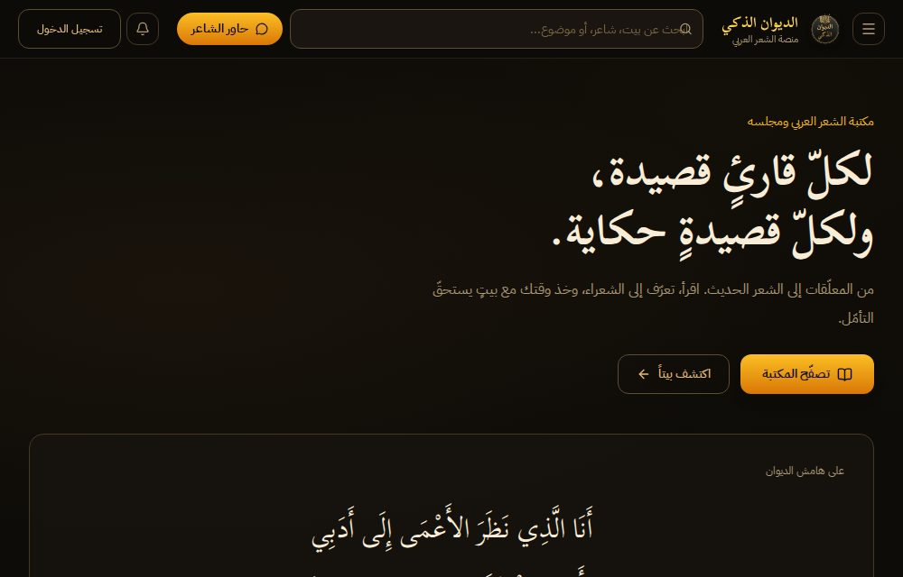
</picture>
</a>

### Sonora

<a href="https://sonora-music-hub-six.vercel.app">
<picture>
  <source media="(max-width: 600px)" srcset="./assets/sonora-preview-mobile.jpg" />
  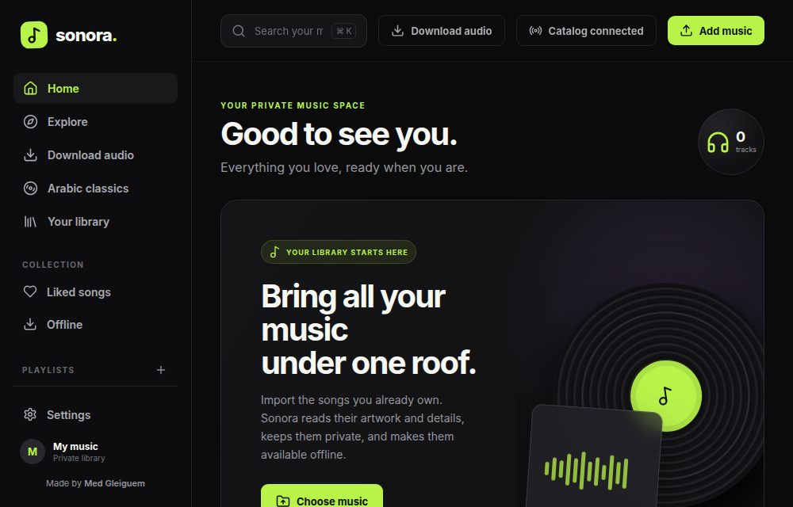
</picture>
</a>

Most of my repositories are **private**. Institutional and research work is represented through summaries; get in touch for a walkthrough of work I can share.

<b>Project notes & engineering decisions</b>

- **Richat AI platforms:** RAG and decision support for the Ministry of Health, Central Bank of Mauritania and ARE. Verified sources, amendment-aware legal retrieval, French/Arabic/English document links, versioning and expert review are central to the work.
- **Taazour Aoun & Taazour Pay:** program platforms reaching 2M+ citizens, with 5.5B MRO distributed, bank integration through GIMTEL and configurable donation workflows. Identity work combines liveness, facial matching and Houwiyeti OTP verification.
- **ANRPTS:** five heterogeneous sources, Airflow, dbt, PostgreSQL, star schemas and SCD2; a 22-module Next.js dashboard. Final-year project score: 19.75/20.
- **BAMIS Sentinel:** fraud detection developed for DATATHON 2026, with explainable scoring, investigation graphs, a dashboard and reproducible deliverables.
- **AI Diwan:** poems, poets and verses with Al-Hakim, an AI assistant for exploring Arabic poetry.
- **Sonora:** React, Next.js, Capacitor and Android Media3. The core is device-local music and offline playback; online streaming and downloading remain experimental.

 

<h2><picture>
  <source media="(max-width: 600px)" srcset="./assets/section-research-mobile.svg" />
  
</picture></h2>

<picture>
  <source media="(max-width: 600px)" srcset="./assets/research-mobile.svg" />
  
</picture>

I’m interested in language technology that serves its speakers: **Arabic poetry**, **Hassaniya**, and **Mauritanian Sign Language**. Corpus work and recognition research are ongoing; **Samia is in design**.

 

<h2><picture>
  <source media="(max-width: 600px)" srcset="./assets/section-stack-mobile.svg" />
  
</picture></h2>

<picture>
  <source media="(max-width: 600px)" srcset="./assets/stack-mobile.svg" />
  
</picture>

**Also in the toolkit:** dbt, vector search, SQL, dimensional modeling, Burp Suite, MediaPipe, REST APIs and CI/CD. I use each where it fits the work.

 

<h2><picture>
  <source media="(max-width: 600px)" srcset="./assets/section-experience-mobile.svg" />
  
</picture></h2>

<picture>
  <source media="(max-width: 600px)" srcset="./assets/timeline-mobile.svg" />
  
</picture>

 

<h2><picture>
  <source media="(max-width: 600px)" srcset="./assets/section-honors-mobile.svg" />
  
</picture></h2>

<picture>
  <source media="(max-width: 600px)" srcset="./assets/honors-mobile.svg" />
  
</picture>

**Mentorship:** Mauritania’s national cybersecurity team · Mentor and judge, Fintech Mauritanie Hackathon. 
**Beyond engineering:** competitive chess, Arabic poetry, and building for local communities. 
**Languages:** Arabic (native) · French (professional) · English (fluent).

 

<h2><picture>
  <source media="(max-width: 600px)" srcset="./assets/section-activity-mobile.svg" />
  
</picture></h2>

<picture>
  <source media="(max-width: 600px) and (prefers-reduced-motion: reduce)" srcset="./assets/activity-mobile-static.svg" />
  <source media="(prefers-reduced-motion: reduce)" srcset="./assets/activity-static.svg" />
  <source media="(max-width: 600px)" srcset="./assets/activity-mobile.svg" />
  
</picture>

<a href="https://github.com/Medgleiguem/Medgleiguem/actions/workflows/profile-activity.yml">Daily activity refresh</a> · <a href="https://github.com/Medgleiguem?tab=overview">GitHub contribution history</a>

GitHub-visible activity includes private contribution counts when GitHub makes them available. Language shares cover **public repositories only**.

<picture>
  <source media="(max-width: 600px) and (prefers-reduced-motion: reduce)" srcset="./assets/skyline-mobile-static.svg" />
  <source media="(prefers-reduced-motion: reduce)" srcset="./assets/skyline-static.svg" />
  <source media="(max-width: 600px)" srcset="./assets/skyline-mobile.svg" />
  
</picture>

<picture>
  <source media="(prefers-reduced-motion: reduce)" srcset="./assets/contributions-static.svg" />
  
</picture>

 

<picture>
  <source media="(max-width: 600px)" srcset="./assets/footer-mobile.svg" />
  
</picture>

<a href="mailto:medgleiguem00@gmail.com"><b>Let’s talk</b></a> · <a href="https://www.linkedin.com/in/med-gleiguem/">Connect on LinkedIn</a> Based in Nouakchott, Mauritania · UTC+0

