<h1><picture>
  <source media="(max-width: 600px) and (prefers-reduced-motion: reduce)" srcset="./assets/observatory-mobile-static.svg" />
  <source media="(prefers-reduced-motion: reduce)" srcset="./assets/observatory-static.svg" />
  <source media="(max-width: 600px)" srcset="./assets/observatory-mobile.svg" />
  
</picture></h1>

**Systems, experiments, research.** Open a card to explore the engineering.

[Systems](#user-content-systems) · [Research](#user-content-research) · [Activity](#user-content-workbench) · [Contact](mailto:medgleiguem00@gmail.com)

## 01 / Evidence systems

<a href="./work/health-ministry.md"><picture>
  <source media="(prefers-reduced-motion: reduce)" srcset="./assets/projects/health-ministry-static.svg" />
  
</picture></a>
<a href="./work/central-bank.md"><picture>
  <source media="(prefers-reduced-motion: reduce)" srcset="./assets/projects/central-bank-static.svg" />
  
</picture></a>
<a href="./work/are-intelligence.md"><picture>
  <source media="(prefers-reduced-motion: reduce)" srcset="./assets/projects/are-intelligence-static.svg" />
  
</picture></a>
<a href="./work/national-knowledge.md"><picture>
  <source media="(prefers-reduced-motion: reduce)" srcset="./assets/projects/national-knowledge-static.svg" />
  
</picture></a>

<h2><picture>
  <source media="(max-width: 600px) and (prefers-reduced-motion: reduce)" srcset="./assets/exchange-mobile-static.svg" />
  <source media="(prefers-reduced-motion: reduce)" srcset="./assets/exchange-static.svg" />
  <source media="(max-width: 600px)" srcset="./assets/exchange-mobile.svg" />
  
</picture></h2>

<a href="./work/anrpts.md"><picture>
  <source media="(prefers-reduced-motion: reduce)" srcset="./assets/projects/anrpts-static.svg" />
  
</picture></a>

<h2><picture>
  <source media="(max-width: 600px) and (prefers-reduced-motion: reduce)" srcset="./assets/identity-mobile-static.svg" />
  <source media="(prefers-reduced-motion: reduce)" srcset="./assets/identity-static.svg" />
  <source media="(max-width: 600px)" srcset="./assets/identity-mobile.svg" />
  
</picture></h2>

<a href="./work/kyc-identity.md"><picture>
  <source media="(prefers-reduced-motion: reduce)" srcset="./assets/projects/kyc-identity-static.svg" />
  
</picture></a>
<a href="./work/taazour-aoun.md"><picture>
  <source media="(prefers-reduced-motion: reduce)" srcset="./assets/projects/taazour-aoun-static.svg" />
  
</picture></a>
<a href="./work/taazour-pay.md"><picture>
  <source media="(prefers-reduced-motion: reduce)" srcset="./assets/projects/taazour-pay-static.svg" />
  
</picture></a>

## 04 / Language, gesture, structure

<a href="./work/hassaniya-laghn.md"><picture>
  <source media="(prefers-reduced-motion: reduce)" srcset="./assets/projects/hassaniya-laghn-static.svg" />
  
</picture></a>
<a href="./work/mauritanian-sign-language.md"><picture>
  <source media="(prefers-reduced-motion: reduce)" srcset="./assets/projects/mauritanian-sign-language-static.svg" />
  
</picture></a>

<h2><picture>
  <source media="(max-width: 600px) and (prefers-reduced-motion: reduce)" srcset="./assets/workbench-mobile-static.svg" />
  <source media="(prefers-reduced-motion: reduce)" srcset="./assets/workbench-static.svg" />
  <source media="(max-width: 600px)" srcset="./assets/workbench-mobile.svg" />
  
</picture></h2>

<picture>
  <source media="(max-width: 600px) and (prefers-reduced-motion: reduce)" srcset="./assets/tools-rail-mobile-static.svg" />
  <source media="(prefers-reduced-motion: reduce)" srcset="./assets/tools-rail-static.svg" />
  <source media="(max-width: 600px)" srcset="./assets/tools-rail-mobile.svg" />
  
</picture>

Other public work

[Sonora](https://github.com/Medgleiguem/sonora-music-hub) · [AI Diwan](https://el-mejlise.vercel.app)

---

[Email](mailto:medgleiguem00@gmail.com) · [LinkedIn](https://www.linkedin.com/in/med-gleiguem/) · [Repositories](https://github.com/Medgleiguem?tab=repositories) · [Activity data](./data/activity.json)
