<h1><picture>
  <source media="(max-width: 600px) and (prefers-reduced-motion: reduce)" srcset="./assets/desert-mobile-static.svg" />
  <source media="(prefers-reduced-motion: reduce)" srcset="./assets/desert-static.svg" />
  <source media="(max-width: 600px)" srcset="./assets/desert-mobile.svg" />
  
</picture></h1>

<a href="#user-content-systems">Domains &amp; tools</a> &nbsp;·&nbsp; <a href="./work/README.md">Work</a> &nbsp;·&nbsp; <a href="#user-content-workbench">Activity</a> &nbsp;·&nbsp; <a href="mailto:medgleiguem00@gmail.com">Contact</a>

## Domains, tools & work

<a href="./work/README.md#user-content-domain-ai"><picture>
  <source media="(max-width: 600px) and (prefers-reduced-motion: reduce)" srcset="./assets/domains/ai-mobile-static.svg" />
  <source media="(max-width: 1279px) and (prefers-reduced-motion: reduce)" srcset="./assets/domains/ai-compact-static.svg" />
  <source media="(prefers-reduced-motion: reduce)" srcset="./assets/domains/ai-static.svg" />
  <source media="(max-width: 600px)" srcset="./assets/domains/ai-mobile.svg" />
  <source media="(max-width: 1279px)" srcset="./assets/domains/ai-compact.svg" />
  
</picture></a>

<a href="./work/README.md#user-content-domain-data"><picture>
  <source media="(max-width: 600px) and (prefers-reduced-motion: reduce)" srcset="./assets/domains/data-mobile-static.svg" />
  <source media="(max-width: 1279px) and (prefers-reduced-motion: reduce)" srcset="./assets/domains/data-compact-static.svg" />
  <source media="(prefers-reduced-motion: reduce)" srcset="./assets/domains/data-static.svg" />
  <source media="(max-width: 600px)" srcset="./assets/domains/data-mobile.svg" />
  <source media="(max-width: 1279px)" srcset="./assets/domains/data-compact.svg" />
  
</picture></a>

<a href="./work/README.md#user-content-domain-software"><picture>
  <source media="(max-width: 600px) and (prefers-reduced-motion: reduce)" srcset="./assets/domains/software-mobile-static.svg" />
  <source media="(max-width: 1279px) and (prefers-reduced-motion: reduce)" srcset="./assets/domains/software-compact-static.svg" />
  <source media="(prefers-reduced-motion: reduce)" srcset="./assets/domains/software-static.svg" />
  <source media="(max-width: 600px)" srcset="./assets/domains/software-mobile.svg" />
  <source media="(max-width: 1279px)" srcset="./assets/domains/software-compact.svg" />
  
</picture></a>

<a href="./work/README.md#user-content-domain-vision"><picture>
  <source media="(max-width: 600px) and (prefers-reduced-motion: reduce)" srcset="./assets/domains/vision-mobile-static.svg" />
  <source media="(max-width: 1279px) and (prefers-reduced-motion: reduce)" srcset="./assets/domains/vision-compact-static.svg" />
  <source media="(prefers-reduced-motion: reduce)" srcset="./assets/domains/vision-static.svg" />
  <source media="(max-width: 600px)" srcset="./assets/domains/vision-mobile.svg" />
  <source media="(max-width: 1279px)" srcset="./assets/domains/vision-compact.svg" />
  
</picture></a>

<a href="./work/README.md#user-content-domain-payments"><picture>
  <source media="(max-width: 600px) and (prefers-reduced-motion: reduce)" srcset="./assets/domains/payments-mobile-static.svg" />
  <source media="(max-width: 1279px) and (prefers-reduced-motion: reduce)" srcset="./assets/domains/payments-compact-static.svg" />
  <source media="(prefers-reduced-motion: reduce)" srcset="./assets/domains/payments-static.svg" />
  <source media="(max-width: 600px)" srcset="./assets/domains/payments-mobile.svg" />
  <source media="(max-width: 1279px)" srcset="./assets/domains/payments-compact.svg" />
  
</picture></a>

<a href="./work/README.md#user-content-domain-nlp"><picture>
  <source media="(max-width: 600px) and (prefers-reduced-motion: reduce)" srcset="./assets/domains/nlp-mobile-static.svg" />
  <source media="(max-width: 1279px) and (prefers-reduced-motion: reduce)" srcset="./assets/domains/nlp-compact-static.svg" />
  <source media="(prefers-reduced-motion: reduce)" srcset="./assets/domains/nlp-static.svg" />
  <source media="(max-width: 600px)" srcset="./assets/domains/nlp-mobile.svg" />
  <source media="(max-width: 1279px)" srcset="./assets/domains/nlp-compact.svg" />
  
</picture></a>

<a href="./work/README.md#user-content-domain-security"><picture>
  <source media="(max-width: 600px) and (prefers-reduced-motion: reduce)" srcset="./assets/domains/security-mobile-static.svg" />
  <source media="(max-width: 1279px) and (prefers-reduced-motion: reduce)" srcset="./assets/domains/security-compact-static.svg" />
  <source media="(prefers-reduced-motion: reduce)" srcset="./assets/domains/security-static.svg" />
  <source media="(max-width: 600px)" srcset="./assets/domains/security-mobile.svg" />
  <source media="(max-width: 1279px)" srcset="./assets/domains/security-compact.svg" />
  
</picture></a>

<a href="./work/README.md#user-content-domain-workflow"><picture>
  <source media="(max-width: 600px) and (prefers-reduced-motion: reduce)" srcset="./assets/domains/workflow-mobile-static.svg" />
  <source media="(max-width: 1279px) and (prefers-reduced-motion: reduce)" srcset="./assets/domains/workflow-compact-static.svg" />
  <source media="(prefers-reduced-motion: reduce)" srcset="./assets/domains/workflow-static.svg" />
  <source media="(max-width: 600px)" srcset="./assets/domains/workflow-mobile.svg" />
  <source media="(max-width: 1279px)" srcset="./assets/domains/workflow-compact.svg" />
  
</picture></a>

**Languages:** Python · TypeScript / JavaScript · SQL · C · Java

Supporting tools &amp; APIs

SQLAlchemy · Django REST Framework · NestJS · Procrastinate · MinIO · GitHub Copilot · Arch Linux

LLM APIs: Claude · Groq · Gemini

## On GitHub

<picture>
  <source media="(max-width: 600px) and (prefers-reduced-motion: reduce)" srcset="./assets/workbench-mobile-static.svg" />
  <source media="(max-width: 1279px) and (prefers-reduced-motion: reduce)" srcset="./assets/workbench-compact-static.svg" />
  <source media="(prefers-reduced-motion: reduce)" srcset="./assets/workbench-static.svg" />
  <source media="(max-width: 600px)" srcset="./assets/workbench-mobile.svg" />
  <source media="(max-width: 1279px)" srcset="./assets/workbench-compact.svg" />
  
</picture>

<a href="./data/activity.json">Activity data ↗</a>

<a href="https://github.com/Medgleiguem?tab=repositories">Repositories</a> &nbsp;·&nbsp; <a href="https://www.linkedin.com/in/med-gleiguem/">LinkedIn</a> &nbsp;·&nbsp; <a href="mailto:medgleiguem00@gmail.com">Email</a>

