<h1><picture>
  <source media="(max-width: 600px) and (prefers-reduced-motion: reduce)" srcset="./assets/observatory-mobile-static.svg" />
  <source media="(prefers-reduced-motion: reduce)" srcset="./assets/observatory-static.svg" />
  <source media="(max-width: 600px)" srcset="./assets/observatory-mobile.svg" />
  
</picture></h1>

I build systems that connect evidence, data and identity — and research tools for the languages and gestures around me.

[Systems](#systems) · [Research](#research) · [Workbench](#workbench) · [Email](mailto:medgleiguem00@gmail.com) · [LinkedIn](https://www.linkedin.com/in/med-gleiguem/)

## 01 · Evidence into decisions

Retrieval boundaries, document identity, and review that remains a human responsibility. The engineering briefs explain the constraints and decisions behind these private systems.

### Health Ministry AI

**Source-grounded assistance with a human decision boundary.** Ministry and domain context follow retrieval into a dossier workflow, keeping evidence, decisions and follow-up connected.

`FastAPI · pgvector · Next.js` · [Engineering brief ↗](./work/health-ministry.md)

### Central Bank / RKF

**Evidence keeps its identity and version context.** A canonical registry, review boundaries and hybrid retrieval preserve provenance across legal and financial material.

`Python · PostgreSQL · React` · [Engineering brief ↗](./work/central-bank.md)

### ARE Intelligence

**Regulatory sources become working evidence.** Source context connects search, obligations and decision views. The current system uses lexical retrieval; generated answers are disabled.

`FastAPI · React · ECharts` · [Engineering brief ↗](./work/are-intelligence.md)

### National Knowledge Base

**A source library with inspectable evidence.** Imports retain provenance; private previews and initial dataset review stay distinct from publication and customer retrieval.

`Django · pgvector · Docling` · [Engineering brief ↗](./work/national-knowledge.md)

<h2><picture>
  <source media="(max-width: 600px) and (prefers-reduced-motion: reduce)" srcset="./assets/exchange-mobile-static.svg" />
  <source media="(prefers-reduced-motion: reduce)" srcset="./assets/exchange-static.svg" />
  <source media="(max-width: 600px)" srcset="./assets/exchange-mobile.svg" />
  
</picture></h2>

### ANRPTS / BI Houwiyeti

**From operational sources to analytical views.** Source contracts and incremental acquisition separate ingestion from transformation. A read-only dashboard boundary keeps analytical access distinct from operational changes.

`Python · Airflow · dbt · PostgreSQL · Next.js` · [Engineering brief ↗](./work/anrpts.md)

<h2><picture>
  <source media="(max-width: 600px) and (prefers-reduced-motion: reduce)" srcset="./assets/identity-mobile-static.svg" />
  <source media="(prefers-reduced-motion: reduce)" srcset="./assets/identity-static.svg" />
  <source media="(max-width: 600px)" srcset="./assets/identity-mobile.svg" />
  
</picture></h2>

### KYC Identity

**Capture, liveness and matching stay distinct.** Partner journeys connect browser capture and vision services to casework and meaningful results. The original platform and v2 remain separate tracks.

`TypeScript · Python · Computer vision` · [Engineering brief ↗](./work/kyc-identity.md)

### Taazour Aoun

**A beneficiary journey with explicit transfer states.** Eligibility, OTP/eKYC and wallet selection form a disbursement workflow. Integration status is documented in the brief.

`Next.js · TypeScript · MongoDB` · [Engineering brief ↗](./work/taazour-aoun.md)

### Taazour Pay

**Payment orchestration across a household boundary.** Provider adapters separate the journey from external payment implementations; a durable household lock controls duplicate success.

`Next.js · MongoDB · Redis · BullMQ` · [Engineering brief ↗](./work/taazour-pay.md)

## 04 · Language, gesture, structure

Local questions, explicit methods. Research in progress.

<picture>
  <source media="(max-width: 600px) and (prefers-reduced-motion: reduce)" srcset="./assets/research-methods-mobile-static.svg" />
  <source media="(prefers-reduced-motion: reduce)" srcset="./assets/research-methods-static.svg" />
  <source media="(max-width: 600px)" srcset="./assets/research-methods-mobile.svg" />
  
</picture>

### Hassaniya Laghn

**Language as structure, not just text.** Corpus preparation and explicit metre and rhyme rules make poetic assumptions inspectable and testable.

`Python · Corpus engineering · Prosody` · [Engineering brief ↗](./work/hassaniya-laghn.md)

### Mauritanian Sign Language

**Better evidence before recognition claims.** Traceable image preparation, quality checks, deduplication and subject-aware splits support research evaluation.

`Python · MediaPipe · Dataset pipelines` · [Engineering brief ↗](./work/mauritanian-sign-language.md)

## 05 · At the workbench

<picture>
  <source media="(max-width: 600px) and (prefers-reduced-motion: reduce)" srcset="./assets/workbench-mobile-static.svg" />
  <source media="(prefers-reduced-motion: reduce)" srcset="./assets/workbench-static.svg" />
  <source media="(max-width: 600px)" srcset="./assets/workbench-mobile.svg" />
  
</picture>

[Activity data](./data/activity.json) · [Daily refresh](https://github.com/Medgleiguem/Medgleiguem/actions/workflows/profile-activity.yml)

### Tools in the work

Python · TypeScript · SQL  
FastAPI · Django · Next.js · React  
PostgreSQL · pgvector · Airflow · dbt · Redis · Computer vision

Other public work

[Sonora](https://github.com/Medgleiguem/sonora-music-hub) · [AI Diwan](https://el-mejlise.vercel.app)

---

**Med Gleiguem / Mauritania** · [Email](mailto:medgleiguem00@gmail.com) · [LinkedIn](https://www.linkedin.com/in/med-gleiguem/) · [Public repositories](https://github.com/Medgleiguem?tab=repositories)
